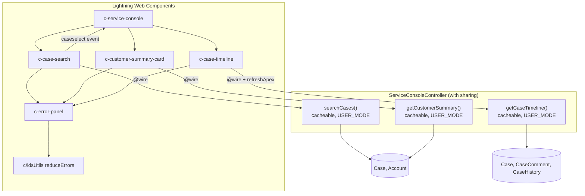

# LWC Service Console

Lightning Web Components for a service agent workspace (debounced case search, customer summary and case timeline), backed by a cacheable, user-mode Apex controller and full Jest coverage.

> **Disclaimer:** Representative portfolio project built independently with synthetic data. It is not code from any employer or client.

## Business use case

Service agents in banking and healthcare contact centres switch between several screens to answer one question: *who is this customer, and what has already happened on this case?* This console puts the three answers on one Lightning page:

1. **Case Search** (`c-case-search`): type part of a case number, subject or customer name. Results arrive as you type, but the server is called only after a 300 ms pause.
2. **Customer Summary** (`c-customer-summary-card`): member tier, member-since date, and open, high-priority and recently closed case counts. A warning appears when high-priority cases are open.
3. **Case Timeline** (`c-case-timeline`): case creation, public and internal comments, and field history, newest first, with a refresh button.

`c-service-console` puts the three together: selecting a search result loads the matching summary and timeline.

## Architecture



Design choices:

- **Wire, not imperative calls.** All reads use `@wire` with reactive parameters, so Lightning Data Service caches results. The timeline uses `refreshApex` for an explicit refresh.
- **DTOs, not SObjects, go to the client.** Each component receives only the fields it renders.
- **One error path.** Every component renders `c-error-panel`, which uses `reduceErrors()` to turn Apex, UI API, JavaScript and plain-string errors into readable messages.
- **Accessible by default.** Labelled search input, `aria-label` on each result button, an `aria-live` result count, `role="alert"` on errors, `aria-expanded` on the error-detail toggle, and visible focus styles. Jest runs axe-core checks through `@sa11y/jest` (`toBeAccessible()`).

## Tech stack

LWC, SLDS (with SLDS 2 styling hooks and fallbacks), Apex (API 62.0), Jest with `@salesforce/sfdx-lwc-jest` and `@sa11y/jest`, ESLint 9 with `@salesforce/eslint-config-lwc`, Prettier, Salesforce Code Analyzer v5, GitHub Actions.

## Project structure

```
lwc-service-console/
├── .github/workflows/ci.yml
├── config/project-scratch-def.json
├── data/                                 # sf data import tree plan (synthetic)
├── force-app/main/default/
│   ├── classes/ServiceConsoleController(.cls|_Test.cls)
│   ├── lwc/
│   │   ├── caseSearch/                   # + __tests__/ with JSON fixtures
│   │   ├── customerSummaryCard/
│   │   ├── caseTimeline/
│   │   ├── serviceConsole/
│   │   ├── errorPanel/
│   │   └── ldsUtils/                     # reduceErrors()
│   ├── objects/Account/fields/           # Member_Tier__c, Member_Since__c
│   └── permissionsets/Service_Console_User.permissionset-meta.xml
├── jest-setup/sa11y.js
├── eslint.config.js
├── jest.config.js
├── code-analyzer.yml
└── package.json
```

## Setup

```bash
sf org login web --set-default-dev-hub --alias devhub
sf org create scratch --definition-file config/project-scratch-def.json --alias console --set-default --duration-days 7
sf project deploy start --target-org console
sf org assign permset --name Service_Console_User --target-org console
sf data import tree --plan data/sample-data-plan.json --target-org console
sf apex run test --target-org console --test-level RunLocalTests --code-coverage --result-format human --wait 20
```

Then, in Lightning App Builder, add **Service Console** to an App Page. You can also put **Customer Summary Card** on an Account record page and **Case Timeline** on a Case record page, where they pick up `recordId` automatically.

## Running Jest, lint and format checks

```bash
npm ci
npm run test:unit            # Jest
npm run test:unit:coverage   # Jest + coverage thresholds (90% lines / 85% branches)
npm run lint                 # ESLint (LWC recommended rules)
npm run prettier:verify      # Prettier (JS, HTML, CSS, Apex, XML)
```

Apex methods are mocked with `createApexTestWireAdapter`, so tests can `emit()` data, raise `error()`, and inspect `getLastConfig()` (for example, to prove the debounce). `refreshApex` is mocked separately. Fake timers drive the debounce tests.

## Synthetic sample data

`data/` contains two fictional customers (one banking-style member, one healthcare-style patient group) and three cases. Every name and value is invented.

## Configuration template

| Setting | Where | Default |
| --- | --- | --- |
| Max search results | `limit-size` property on `c-case-search` (server caps it at 50) | 25 |
| Minimum search length | `MIN_SEARCH_LENGTH` in `caseSearch.js` and `ServiceConsoleController` | 2 |
| Debounce delay | `DEBOUNCE_MS` in `caseSearch.js` | 300 ms |
| Timeline size | `TIMELINE_LIMIT` in `ServiceConsoleController` | 100 per source |

## Security considerations

- `ServiceConsoleController` is `with sharing`, and every query uses `WITH USER_MODE`, so CRUD, FLS and sharing apply to the running agent.
- Exceptions become `AuraHandledException` with generic, user-safe messages. Stack traces and field names are never sent to the browser.
- `LIKE` wildcards in user input are escaped (`%`, `_`, `\`), and all values are bind variables, never string-concatenated SOQL.
- Result size is capped on the server, whatever the client asks for.
- Access is through the `Service_Console_User` permission set. Apex tests run as a Standard User with that permission set.
- No credentials, endpoints or personal data are in the repository. Fixtures use obviously fake Ids and names.

## Testing approach

**Jest (40 tests, 6 suites):** rendering, debounce timing, minimum length hint, results and badges, the `caseselect` event payload, empty states, error panels, the refresh flow, `caseId`/`recordId` aliasing, `reduceErrors` across every error shape, and axe accessibility checks. Coverage at the time of writing: about 99% statements and 95% branches.

**Apex (`ServiceConsoleController_Test`):** search by subject and account name, short-term short-circuit (no SOQL), LIKE escaping, limit clamping, summary counts, timeline creation and comment entries, field-change formatting, sort order with null timestamps, and required-Id validation. Tests run as a Standard User with the permission set.

> Apex tests need an org. They run in the optional CI scratch-org job.

## Continuous integration

`.github/workflows/ci.yml`:

1. **static-checks:** `npm ci`, then Prettier check, ESLint, Jest with coverage thresholds, and Salesforce Code Analyzer (fails on High or Critical findings, uploads an HTML report).
2. **scratch-org-validate (optional):** guarded by the `SFDX_AUTH_URL` secret. It creates a scratch org, deploys, runs Apex tests, and deletes the org.

## Limitations and future enhancements

- `CaseHistory` only has rows when field history tracking is enabled for Case. History rows are not created inside Apex tests, so the mapping is unit tested directly.
- Strings are hard-coded in English. Production code would use Custom Labels.
- Search uses SOQL `LIKE`. For large volumes, SOSL or a search index would scale better.
- Possible additions: Lightning Message Service for console-wide selection, infinite scroll, and a `lightning-datatable` view with sorting.

## License

[MIT](LICENSE). Copyright (c) 2026 Vanaja Kumari.
